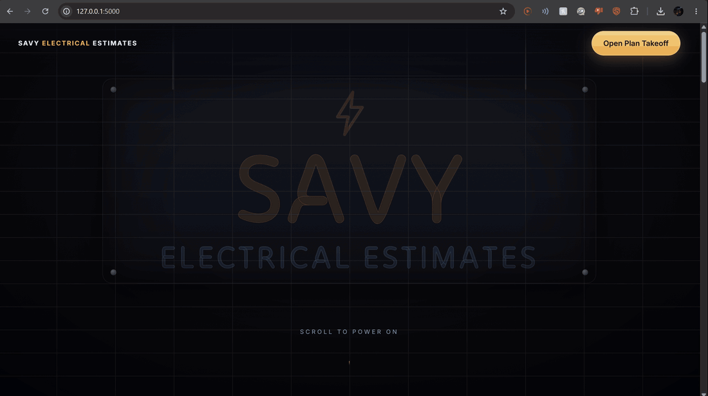

<div align="center">

# ⚡ Savy Electrical Estimates
### Plan Takeoff

**Upload an electrical plan. Get every symbol counted, every wire run measured, and a priced estimate, with a person reviewing every number.**



*Built solo for the Meta Global AI Developer Hackathon 2026 (indie track) by [Xavier Cabrera](https://www.linkedin.com/in/xaviercabrera28/)*

</div>

> **Planning aid only.** Output is a first-pass count for an estimator to review. It is not a substitute for a licensed electrician, the drawings, or the local inspector.

---

## Why I built it

I'm training as an electrician. Estimating a job from a plan means counting every outlet, switch and light by hand, measuring the wire between them, and pricing the parts. It is slow and easy to get wrong. Plan Takeoff does the first pass so the estimator spends their time checking, not counting.

## What it does

| | |
|---|---|
| **Reads the plan's own legend** | Every plan defines its own symbols. A Meta vision model finds the legend and returns each symbol's box and printed name as structured JSON; code snaps each box to the actual ink. No hard-coded symbol list. |
| **Finds and counts symbols** | Multi-scale template matching (normalized cross-correlation) with non-maximum suppression, then rule checks that throw out false hits such as letters in room names. |
| **Traces the wire runs** | Follows the dashed switch-control lines from switch to light, and converts length to feet from a scale you set by dragging along a known dimension. Wrong run? Draw it by hand. |
| **Lets a person review everything** | Click a type in the counts to see every hit as a card with a close-up, numbered on the plan. Remove, retype or add. Undo, autosave, pan/zoom, pinch-to-zoom on touch screens. |
| **Builds the estimate** | Materials (quantity × price, markup), labor (hours × rate) and contingency, once you confirm the legend mapping. Prices come with source links and are editable. Optional: search Home Depot / Lowe's for product options and click the one you want. |
| **Looks the part** | Scroll-animated landing page with a neon sign that powers on, and a responsive app that works on phones. |

## Quick start

1. Install **Python 3.10+** from [python.org](https://www.python.org/downloads/) (Windows: tick *Add python.exe to PATH*).
2. Create a file named `.env` next to this README:
   ```
   MODEL_API_KEY=your_meta_model_key
   MODEL_NAME=muse-wonder-1.0
   ```
   Keep it private. It is already in `.gitignore`.
3. **Windows:** open a terminal in this folder and run `.\start.bat`.
   **Mac:** double-click `start.command` (first time: right-click → Open).
4. Your browser opens on the landing page. Press **Open Plan Takeoff**, then **Load sample plan** or **Upload plan**.

The first run installs the packages it needs (a minute or two).

### Run it by hand

```bash
pip install -r requirements.txt
python backend/app.py            # http://127.0.0.1:5000
```

| URL | Page |
|---|---|
| `/` | Landing page |
| `/app` | The Plan Takeoff app |

Without a key the app still works: you draw each legend symbol by hand and detection runs on templates alone.

## Using it on your own plan

1. **Upload** a PNG, JPG or PDF. With a key, the legend is read and detection runs automatically.
2. **Check the legend thumbnails.** *Redo* fixes a wrong crop; *Draw* adds a missing one.
3. **Review the counts.** Click a type (for example *Switch*) to see every hit. Remove or retype the wrong ones. *Review flagged* steps through uncertain hits.
4. **Wire runs:** press **Set scale**, drag along a length printed on the plan, type its feet. Runs convert to feet. Use **Draw wire run** to add or fix one.
5. **Estimate:** tick *These match the legend*. Adjust labor rate, markup and contingency, overwrite any price, and use *Add part* for anything not on the plan.
6. **Export** counts, material list, estimate CSV, or JSON.

Keyboard: `1`–`9` relabel · `Delete` removes · `Esc` closes · `Ctrl+Z` undoes · `F` fits the plan.

## How it works

```
plan (PNG / JPG / PDF)
  │
  ├─ legend.py     Meta vision model -> legend region + one box per symbol (JSON-schema output, 0-1000 grid),
  │                boxes snapped to ink; line styles (dashed wires) are kept apart from device symbols
  │
  ├─ detect.py     multi-scale template matching per symbol, per-symbol thresholds, stretched templates for box symbols
  ├─ verify.py     NMS with runner-up labels · geometric text-row filter (connected components) ·
  │                optional OCR word check · bigger-template-wins rule (duplex vs GFCI) · confidence flags
  ├─ (optional)    Meta model verifies each candidate against the legend crops
  │
  ├─ wires.py      dash segmentation by legend colour/size -> union-find chaining -> longest path through the
  │                minimum spanning tree -> Douglas-Peucker simplification -> attach ends to devices.
  │                Falls back to learning the dash style from the plan if the legend sample is unusable.
  │
  ├─ review UI     plain JS + SVG: edit, undo, autosave, numbered review lists, hand-drawn runs
  └─ estimate      counts × materials + wire feet × waste, labor hours, markup, contingency
```

**Why template matching first:** it is free, deterministic and needs one example per symbol, which suits legends that differ on every plan. The model is used where it is strong (reading a messy legend, optionally verifying hits) and plain code makes the counting decisions, so those decisions can be tested.

### Project layout

```
backend/
  app.py              Flask API + page routes
  symbols.json        built-in symbol types, materials and settings
  prices.json         researched starting prices, each with a source link
  pipeline/
    legend.py         legend reading with the vision model
    detect.py         template matching
    verify.py         rules, text filter, flags
    wires.py          dashed-wire tracing
    run.py            orchestration
    vlm.py            Meta Model API client
    prices_live.py    optional Home Depot / Lowe's product search
frontend/
  landing.html        scroll-animated landing page
  index.html, app.js, style.css    the app
  fx.js, splash.js    background effects and intro
eval/                 count-level evaluation against your own hand counts
samples/plan_01/      sample plan with legend crops
```

## Pricing

Starting prices live in `backend/prices.json`, each with a source link and an "as of" date. Labor hours, markup and contingency are **assumptions you can edit**; the estimate excludes permits, breakers, service work and anything not in the legend.

The optional **Search the web for prices** button asks for product options from Home Depot and Lowe's only. The Meta model writes the exact product search, only product pages are kept, and a price counts as sourced only if the number appears in the page result. Pick one of up to three options per part and its price goes into the estimate. For more reliable results, add `TAVILY_API_KEY` or `BRAVE_API_KEY` to `.env`.

## Evaluate it

Hand-count a plan, then measure the pipeline against your count:

```bash
python eval/run_eval.py          # reads samples/*/ground_truth.json
```

See `eval/ground_truth.template.json` for the format.

## Known limits

- **Recall is imperfect.** Symbols drawn at odd orientations can be missed, and look-alikes (dimmer vs door bell, electrical panel vs exhaust fan) can be confused. The review list exists for exactly this.
- **It needs a legend**, or you draw the reference symbols by hand.
- **Tuning so far used a small number of plans.** Don't quote an accuracy figure until you have run `eval/` on several of your own.
- **Wire tracing** can fail where runs cross or hide behind symbols. Draw those by hand.
- **Web prices depend on what the search returns.** Store pages often hide prices from search results; treat unsourced numbers as estimates.
- No room-by-room counts and no multi-page plans yet.

## Roadmap

- Labeled test set and precision/recall numbers
- Trained detector once there is enough labeled data
- Multi-page plans and room-by-room counts
- Per-job labor from a rate sheet instead of fixed hours

## Built with

Python · Flask · OpenCV · NumPy · Pillow · pypdfium2 · plain JavaScript and SVG · Meta Model API · Playwright (end-to-end tests)

## Author

**Xavier Cabrera** · [GitHub @YoungSavy28](https://github.com/YoungSavy28) · [LinkedIn](https://www.linkedin.com/in/xaviercabrera28/)

© 2026 Savy Electricals. First-pass counts only; a person reviews every estimate.